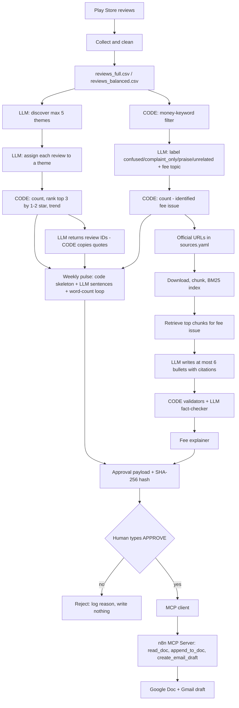

# Architecture: Review Pulse for ChatGPT

**Based on:** PRD.md  |  **Stack:** Python 3.11, Streamlit, Groq LLM, BM25 retrieval, n8n MCP server, Google Docs and Gmail

---

## 1. System overview

Two pipelines plus a publishing layer:

1. **Review Intelligence pipeline** (structured LLM labelling, deterministic counting)
2. **Fee Explainer RAG pipeline** (official pages, retrieval, grounded writing, fact-check)
3. **Publishing layer** (approval gate, then MCP tool calls through n8n)



## 2. Core design rule: who is allowed to do what

| Task | LLM | Code |
|---|---|---|
| Propose themes, assign review to theme | Yes (JSON only) | Validate JSON, enforce max 5 |
| Counting, ranking, trends, percentages | **Never** | Always |
| Pick which review is a good quote | Returns ID (and optional excerpt) | Copies text, verifies substring |
| Write sentences in the pulse | Yes (no digits for counts) | Inserts all numbers, counts words |
| Choose official URLs | **Never** | Read from `config/sources.yaml` |
| Write fee bullets | Yes, only from retrieved chunks | Validate count, citations, numbers, tone words |
| Fact-check a bullet | Yes (yes/no with reason) | Enforce reject/rewrite loop |
| Decide to publish | **Never** | Only after typed `APPROVE` |
| Choose which MCP tool to call | **Never** | Fixed order, direct calls |

## 3. Repository layout

```
review-pulse-chatgpt/
  CLAUDE.md                      # project memory: rules for the AI agent
  .cursor/rules/review-pulse.mdc # alwaysApply: read CLAUDE.md
  .env.example  .gitignore  requirements.txt  Makefile  README.md
  config/
    product.yaml                 # app_id, country, lang, weeks, keyword lists, tie-break rule
    sources.yaml                 # official URLs (user-supplied), source_id, title
  data/
    reviews_full.csv  reviews_balanced.csv
    themes.json  assignments.csv  fee_labels.csv  insights.json
    sources/<source_id>.txt  chunks.jsonl
    cache/                       # LLM answers keyed by hash
  outputs/
    weekly_pulse.md  fee_explainer.md  approval_payload.json
    email_draft.txt  publish_log.jsonl  checks_report.md
  src/
    config.py  errors.py  logging_config.py  llm.py  types.py
    collect/   scrape.py  clean.py
    analyze/   themes.py  classify.py  rank.py  quotes.py  fee.py  trend.py
    writer/    pulse.py  wordcount.py
    rag/       fetch.py  chunk.py  index.py  explain.py  validate.py  factcheck.py
    mcp_client/ client.py  test_connection.py
    approval/  payload.py  gate.py  publish.py
    checks/    run_checks.py  bad_inputs.py
  app/
    streamlit_app.py  pages/ (Overview, Insights, Pulse, Fee, Approve, Checks, About)
  n8n/       workflow.export.json (no credentials)  README.md
  docs/      PRD.md  architecture.md  implementation.md  sources.md
  tests/
```

## 4. Data model (files, not a database)

**reviews_full.csv:** `review_id, date, week_start, rating, text`
**assignments.csv:** `review_id, theme_id`
**themes.json:** `[{theme_id, name, description}]` (max 5)
**fee_labels.csv:** `review_id, stance, fee_topic` where stance is one of `confused | complaint_only | praise | unrelated`
**insights.json (all computed by code):**

```json
{
  "window": {"start": "", "end": "", "weeks": 0, "review_count": 0},
  "themes": [{"theme_id": "", "name": "", "total": 0, "low_star": 0, "low_star_share": 0.0}],
  "top3": ["theme_id", "theme_id", "theme_id"],
  "ranking_rule": "low_star desc, then low_star_share desc, then name",
  "quotes": [{"theme_id": "", "review_id": "", "excerpt": "", "rating": 1, "date": ""}],
  "trend": [{"theme_id": "", "prev4": 0, "last4": 0}],
  "voice_tag": {"count": 0, "low_star": 0},
  "fee": {"topic": "", "confused": 0, "complaint_only": 0, "praise": 0, "unrelated": 0, "money_reviews": 0}
}
```

**Principle:** store facts, compute answers. Derived values (ranks, shares, trends) are recomputed from `assignments.csv` and `reviews_full.csv` every time and are never typed by the LLM.

## 5. LLM layer (`src/llm.py`)

- One function `ask_json(prompt, schema, cache_key)`: calls Groq, forces JSON-only output, validates keys by hand, retries up to 2 times on invalid JSON, caches the validated answer.
- Config: `LLM_PROVIDER=groq`, `LLM_MODEL` in `.env` (check current free models at console.groq.com), `TEMPERATURE=0` for labelling.
- Rate limiting: batch size about 25 reviews, each trimmed to about 300 characters with short IDs; exponential backoff on 429.
- Cache: `data/cache/<sha256(model+prompt)>.json`. Cached runs make zero API calls.

## 6. Context engineering decisions

| Decision | Why |
|---|---|
| Mixed 150-review sample for theme discovery (angry, neutral, happy) | Avoids themes dominated by one mood |
| Balanced file, max 200 per week | Stops a busy week from dominating |
| Reviews trimmed to about 300 chars, short IDs | Fits free-tier token limits, reduces noise |
| Closed label sets (themes, stance, fee topics) | Constrains output so code can validate it |
| LLM gets counts as variables, never asked to derive them | Prevents confident wrong numbers |
| Fact-checker sees only one bullet and its one cited chunk | Small context makes verification reliable |
| Retrieval limited to top 4-6 chunks | Keeps explainer grounded and short |
| Cache everything | Reproducible, cheap reruns, fast demo |

## 7. Fee Explainer RAG design

**Ingestion (run once, cached on disk):** Load (fetch each URL in `sources.yaml`, extract text with trafilatura, fall back to BeautifulSoup) then Clean then Chunk (about 300-500 tokens, sentence-aware, 15% overlap, section headings kept as metadata) then Index (BM25 via `rank_bm25`; stored as `chunks.jsonl`).

**Why BM25 and not embeddings:** the corpus is 4-6 small pages, so lexical search works well. It adds no heavy model download and runs inside Streamlit Cloud's memory limit. If your course expects embeddings, `rag/index.py` exposes one `search(query, k)` interface so a sentence-transformers + Chroma backend can replace BM25 without touching other modules.

**Chunk metadata:** `chunk_id, source_id, source_url, section, fetched_at, text`.

**Query:** query string is built from the identified fee topic plus the top confused-review phrasing (computed text, not LLM output). Retrieve top k=5.

**Generation:** prompt contains only the retrieved chunks and rules: at most 6 bullets, neutral tone, each ends with `[source_id]`, no figures unless present in a chunk, no advice.

**Validation (code):** bullet count at most 6; each cites a known `source_id`; every number and percentage appears in the cited chunk text; banned opinion words absent; exactly 2 official links; `Last checked` present.

**Fact-check (LLM, separate call):** input = one bullet + its cited chunk only. Output `{"supported": true|false, "reason": ""}`. Unsupported bullets get one rewrite; still failing means dropped. If fewer than 4 bullets remain, status becomes `needs_human_review` and publishing is blocked.

## 8. MCP design

**Server (n8n, no code):** MCP Server Trigger (Bearer auth) with three tools.

| Tool | n8n node | Safety property |
|---|---|---|
| `append_to_doc(text)` | Google Docs tool: append | Document ID typed into the node; cannot target another doc |
| `read_doc()` | Google Docs tool: get | Read-only |
| `create_email_draft(subject, body)` | Gmail tool: create draft | Recipient fixed in the node; **no Send node exists** |

**Client (`src/mcp_client/client.py`):** Python `mcp` SDK. Connect with the production URL and `Authorization: Bearer <token>`. Support streamable HTTP and SSE transports (use whichever the n8n URL supports). `test_connection.py` lists tools and asserts exactly the three expected names and that none contains "send".

**Why direct calls, not an agent:** after approval the app calls tools in a fixed order. An agent could reword, repeat or skip calls.

## 9. Approval state machine

```
DRAFT -> PAYLOAD_BUILT -> AWAITING_APPROVAL -> APPROVED -> DOC_CHECKED -> DOC_WRITTEN -> DOC_VERIFIED -> EMAIL_DRAFTED -> DONE
                                  |                              |
                                  +-> REJECTED (reason logged)   +-> STOPPED_DUPLICATE / STOPPED_HASH_MISMATCH / FAILED(resume)
```

- Payload = canonical JSON `{doc_entry, email_subject, email_body}` with sorted keys.
- `hash = sha256(payload)`. Shown on screen and stored in the log and in the Doc entry.
- Approval input must equal `APPROVE` exactly.
- Before every write: recompute the hash; mismatch means stop.
- Duplicate check: `read_doc` and look for the week label; found means stop.
- Verify: `read_doc` after write and confirm the entry text is present.
- `publish_log.jsonl` appends one JSON line per step (state, time, hash, tool, ok or error text). Resume starts from the last successful state.

## 10. Streamlit app

| Page | Shows |
|---|---|
| Overview | Window, review count, weeks, pipeline status |
| Insights | Themes table, top 3, trend, quotes, fee stance counts |
| Weekly Pulse | The pulse, word count |
| Fee Explainer | Bullets, citations, fact-check results, links, Last checked |
| Approve and Publish | Full payload, hash, `APPROVE` box, Reject with reason, step progress |
| Checks | Latest `checks_report.md` |
| About | Method, limits, disclaimer |

- `DEMO_MODE=true` (hosted): loads cached artifacts only, hides scrape/LLM run buttons.
- Approve page requires `APPROVER_PASSWORD` from Streamlit secrets.
- The Approve page calls `src/approval/publish.py`, the same code path the CLI uses.

## 11. Configuration and secrets

| Variable | Where | Purpose |
|---|---|---|
| `GROQ_API_KEY` | `.env` / Streamlit secrets | LLM calls |
| `LLM_MODEL` | `.env` | Groq model id |
| `N8N_MCP_URL` | `.env` / secrets | MCP production URL |
| `N8N_MCP_TOKEN` | `.env` / secrets | Bearer token |
| `APPROVER_PASSWORD` | secrets | Gate for hosted approve page |
| `DEMO_MODE` | `.env` / secrets | true on hosted app |

`.env` and `data/cache/` are in `.gitignore` from the first commit.

## 12. Verification architecture (`make checks`)

Independent rule-based checks, no LLM, each prints PASS/FAIL and continues:
data (columns, no PII, 8-12 weeks) | themes (at most 5, exactly 3 top, recomputed counts equal) | quotes (verbatim in CSV) | pulse (at most 250 words, four sections, three actions) | explainer (at most 6 bullets, 2 links, numbers traceable, 0 rejections) | safety (hash matches, read-back succeeded, no tool named send) | bad inputs (empty file, missing column, 20 rows, ratings 0 or "good", phone number in text, 20 weeks).

## 13. Deployment

- **GitHub** repo, clean history, no secrets.
- **Streamlit Community Cloud**: point at `app/streamlit_app.py`, paste secrets, `DEMO_MODE=true`. Cached artifacts (`insights.json`, pulse, explainer, chunks) are committed so the hosted app needs no LLM call.
- **n8n cloud**: workflow active, production URL used. Export the workflow JSON (no credentials) to `n8n/`.
- Note: Streamlit Cloud's file system is not persistent, so the hosted publish log is for the session only; keep the real log from your local run as evidence.

## 14. Failure modes

| Failure | Behaviour |
|---|---|
| Scraper returns fewer than 8 weeks | Pipeline stops with a clear message |
| LLM returns invalid JSON | 2 retries, then domain error shown in UI |
| More than 5 themes returned | Rejected and retried |
| Quote excerpt not a substring | Fall back to first 25 words of the real review |
| Official page download fails | Use manual paste fallback file; Last checked uses the paste date |
| Fact-check rejects bullets | Rewrite once, then drop; below 4 means block publish |
| MCP auth/URL error | Connection test prints which one is wrong |
| Hash mismatch / duplicate | Stop, log, no write |
